# Typsastra

> A complex-script-first Typst environment for research and long-form multilingual writing.

## Download Typsastra

Typsastra has pre-built desktop releases.

[Download the latest release](https://github.com/Sovichea/typsastra/releases/latest)

Available packages:

- Windows: `.msi` for x64 and ARM64
- Linux: `.AppImage` and `.deb`
- macOS: experimental, unsigned and unnotarized build

Typsastra is currently beta software. The latest release is v0.10.2.

Windows users can install from the project Scoop bucket:

```powershell
scoop bucket add typsastra https://github.com/Sovichea/scoop-typsastra
scoop install typsastra
```

The winget manifest is still awaiting upstream review and is not available yet.

Typsastra is an open-source project and does not plan to purchase Apple
Developer ID signing or notarization. On macOS, Gatekeeper may therefore report
the experimental build as damaged. Download it only from the official release
page, then follow the narrowly scoped workaround in the
[installation guide](./docs/INSTALL.md#open-an-unsigned-macos-release).
Do not disable Gatekeeper globally.

[](https://github.com/Sovichea/typsastra/releases/latest)
[](./LICENSE)
[](https://tauri.app/)

<p align="center">
  
</p>

## What is Typsastra?

Typsastra is a local-first writing environment for Typst, designed for research papers, technical documentation, theses, books, and other long-form documents.

Typsastra (pronounced “tip-SAS-tra”) began with a relatively focused goal: make writing complex scripts easier and more natural in a Typst editor.

The name combines Typst, the typesetting system at the center of the project, with *sastra*—a word associated with writing, literature, and knowledge. It reflects the idea that a document editor should support not only typesetting, but also the languages, scripts, and long-form work that give writing its meaning.

It serves writers and researchers whose languages are not always well supported by traditional technical-writing tools. Typsastra focuses on Unicode-safe editing, script-aware interaction, responsive PDF preview, extensible language tools, and multi-file project workflows while keeping the underlying Typst source portable.

Khmer is the first language with deep support, including tailored cursor and deletion behavior, spellcheck, and word completion. Khmer demonstrates the depth Typsastra aims to provide; it is not the boundary of the project. The editing-policy and language-provider architecture is designed so other languages can add their own behavior without changing or weakening Khmer support.

## Key features

- **Draft Preview for images and diagrams** — layout-preserving placeholders for
  supported images, Fletcher diagrams, and CeTZ canvases, with cached hover
  thumbnails and automatic background measurement.
- **Table Tools** — a spreadsheet-style grid, linked table blocks, reusable
  styles, CSV/TSV import, and lossless `.typ` export.
- **Project-wide search and reviewed replacement** — find and replace across
  files with an explicit review step.
- **Unsaved-work recovery** — snapshots kept outside the project and reviewed as
  unified diffs before restoring them as unsaved buffers.
- **Shared main-document outline and navigation** — an outline while editing
  included chapters, Back/Forward history, and a tab-list menu.
- **Project templates** — create from Typst Universe, downloaded, managed user
  `.typsastra`, or blank projects.
- **Standalone Typst, Markdown, and PDF files** — edit or view files outside a
  project, and promote a standalone Typst document into a full project.
- **Complex-script editing** — Unicode-safe ranges, script-aware cursor and
  deletion behavior, Khmer deep support, Lao segmentation, and bundled English
  spellcheck with optional Hunspell dictionaries.
- **Language and typography controls** — document-language routing, script-aware
  spellcheck and completion, font fallback, and per-script visual scaling.
- **Tinymist diagnostics and completion** — live errors, completion, formatting,
  and source maps through a validated system or managed toolchain.
- **PDF preview and synchronization** — virtualized live preview, forward and
  inverse sync, preserved scroll position, color modes, zoom, live-preview
  search, and docked or undocked windows.
- **Reliable PDF export** — the optional Enhanced Unicode Engine, cancellable and
  transactional compilation, and explicit compiler provenance.
- **Standalone PDF viewing** — Unicode-aware search, selection, copy, links, and
  outlines.
- **Image Tools** — raster inspection, non-destructive optimization previews,
  optimized copies, and explicit reference updates.
- **Markdown live preview** — sanitized GFM with workspace-bound local
  resources.
- **Low-Memory Mode** — one-shot compilation and a cached navigation index for
  very long documents.
- **Local-first projects** — portable Typst source; multi-file chapters,
  includes, bibliographies, figures, and data; `.typsastra` workspace state;
  machine-local render caches; recent-project history; and signed update
  detection.
- **Customizable keyboard shortcuts** for application and editor commands.

## Bundled examples

The writable examples are organized by capability rather than by release
number. Start with `START-HERE.typ`, then explore `06-preview-and-media` for
Draft Preview, nested image helper chains, preview navigation, private fonts,
and Markdown notes, `07-editor-workflows` for search, recovery, outline,
history, and document-language defaults, or `08-tools-and-templates` for linked
Table Tools blocks and project creation.

The image helper exercise shows the same current behavior in Normal and Draft
preview: inverse sync selects the outermost call that supplied the image, and
Draft Preview replaces that call with a layout-preserving placeholder using the
helper's resolved width and height. Hovering the placeholder reveals the cached
image and its source dimensions without loading the original asset into the
Draft document.

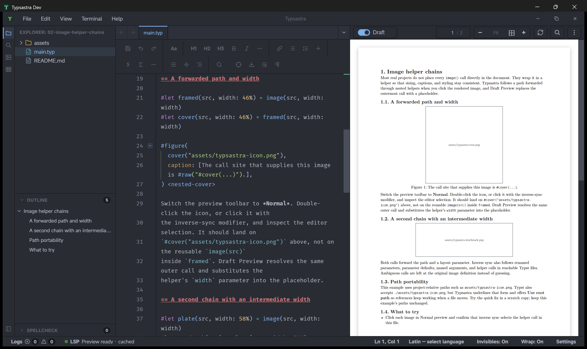

The `08-tools-and-templates` exercises cover project-owned Table Tools blocks,
table export/import, and project creation from templates. The linked-table
example can recover its table model from generated source when project metadata
is missing.

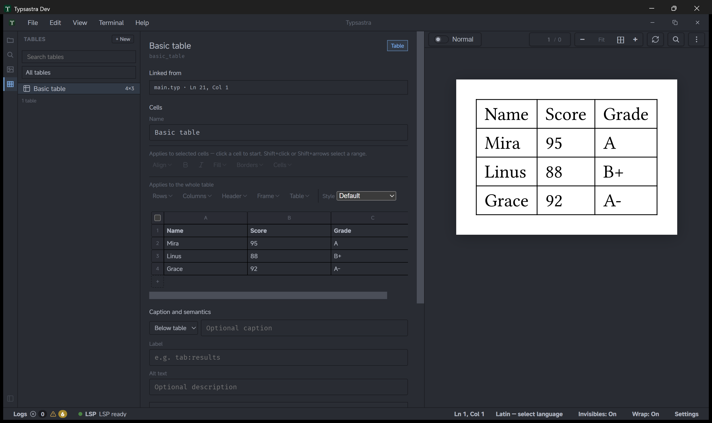

## Screenshots

### Project workspace

<p align="center">
  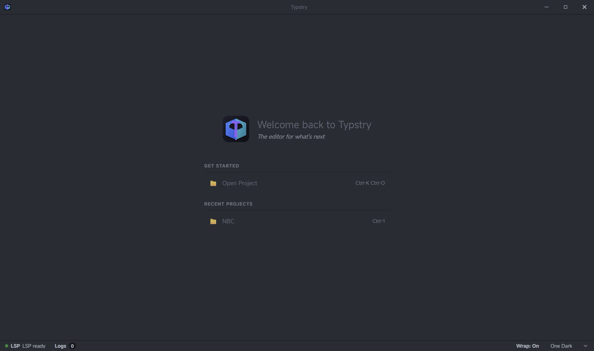
</p>

### Editor and document preview

<p align="center">
  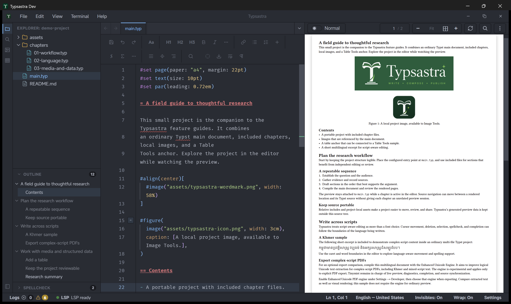
</p>

### Khmer script-aware editing and language tools

<p align="center">
  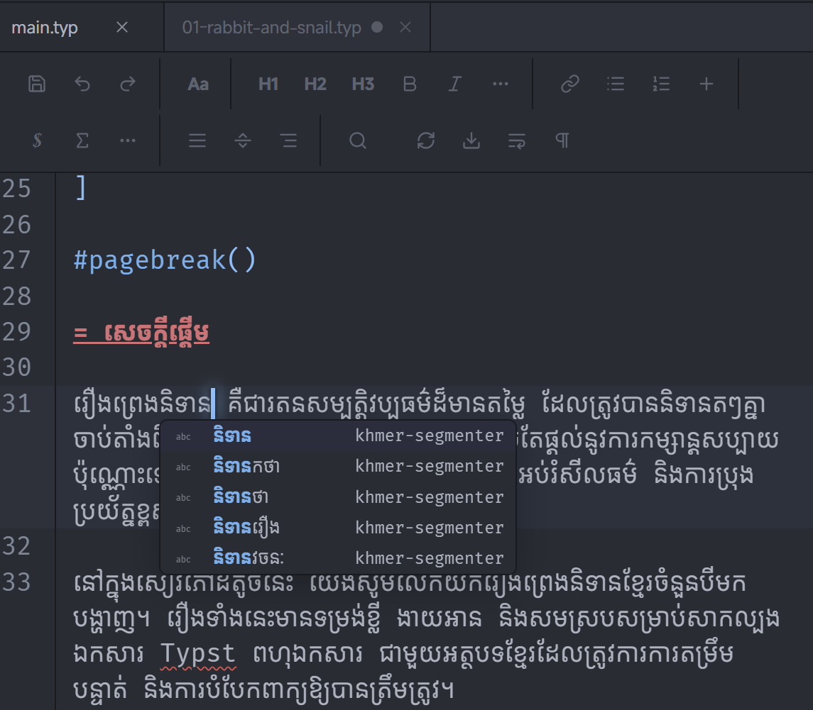
</p>

### Draft Preview

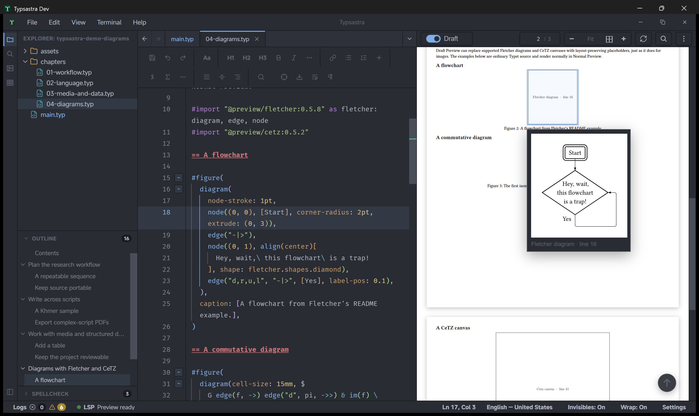

### Image Tools

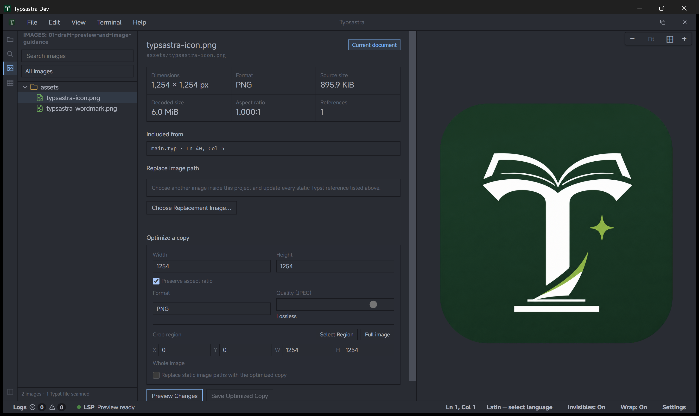

### Table Tools

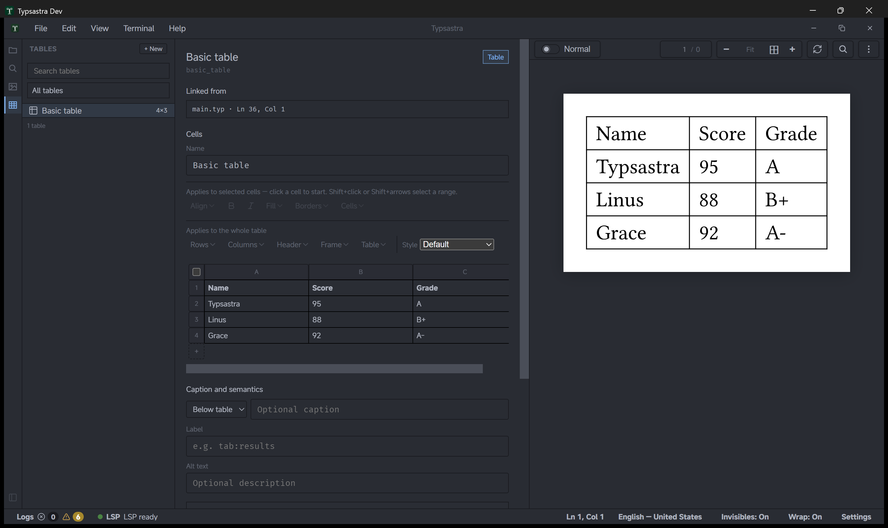

### Project creation and search

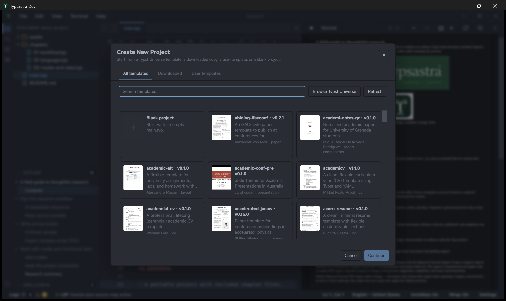

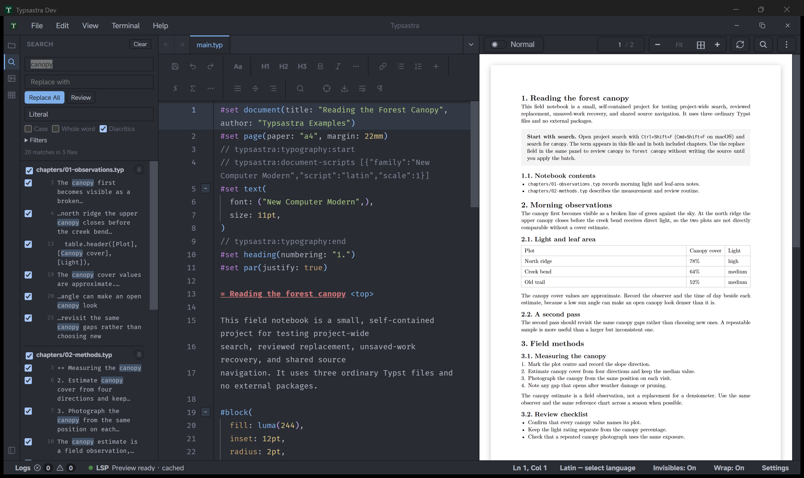

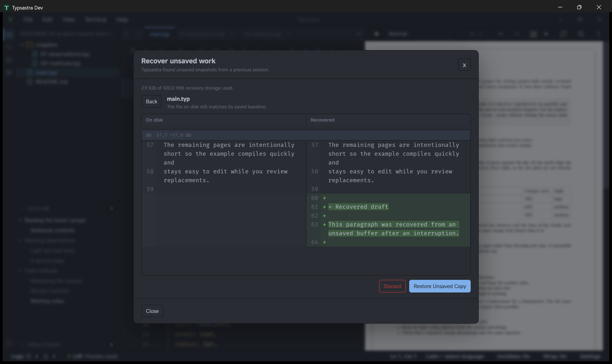


## Why Typsastra?

Most editors treat complex-script support as a font or rendering concern. Reliable authoring also depends on cursor boundaries, deletion behavior, IME input, Unicode-safe ranges, language segmentation, completion, search, diagnostics, and consistent source-to-preview navigation.

Typsastra treats these as core editor responsibilities. Script-aware editing policies remain separate from dictionaries and language tools, allowing each language to tailor only the behavior it owns. Khmer is the reference implementation for this architecture.

Typsastra also treats a document as a project rather than an isolated file. A real research document may contain a main file, templates, chapters, includes, bibliography databases, figures, data, and files that can be previewed independently. Typsastra is being designed around that structure while preserving compatibility with the standard Typst ecosystem.

## Language support

Language support is capability-based rather than all-or-nothing:

- **Deep support** includes a script editing policy, reliable segmentation, spellcheck, and word completion. Khmer is the first and reference deep implementation.
- **Enhanced support** adds a tokenizer or language-specific boundary logic without requiring custom editor behavior. Lao uses ICU4X word segmentation at this level.
- **Basic support** uses a compatible Hunspell dictionary where available. This can provide useful spellcheck, but it is not presented as reliable segmentation for languages that require a dedicated tokenizer.

Each language entry in Settings shows its support level, stability status, and which capabilities are actually available. The long-term goal is for contributors to add a language through explicit policy and provider modules without modifying generic CodeMirror integration or another language's implementation.

## Research-document workflow

Typsastra is designed around one project identity and one configured main document. Opening an included chapter keeps the full-document preview, shared page position, and source relationships intact instead of treating every active file as a separate document. Once a guarded large document is approved, its included source files reuse that project-level approval rather than repeatedly interrupting the author.

The scalable workflow covers:

- project and main-document identity;
- included chapters, templates, imports, bibliographies, figures, and data;
- debounced render-on-type for responsive short-document iteration and
  per-workspace render-on-save for long or resource-intensive documents;
- revision-safe diagnostics, language analysis, compilation, and source navigation;
- virtualized preview rendering for long PDFs;
- workspace restoration and recovery after compiler or LSP failures.

The detailed architecture and trackable work are recorded in the [complex-script-first implementation plan](./docs/COMPLEX_SCRIPT_FIRST_IMPLEMENTATION_PLAN.md).

## Preview synchronization

Typsastra keeps one live preview pinned to the configured main document, including
while editing files imported or included by that document.

Forward sync is currently a manual action so ordinary cursor movement and tab
switching never move the preview unexpectedly. To reveal the editor cursor in
the preview, use the **Reveal Cursor in Preview** button in the preview toolbar,
or press:

- Windows and Linux: `Alt+Enter`
- macOS: `Option+Enter`

Tinymist currently resolves this action to the correct PDF page and source line,
with the preview ripple appearing at the beginning of that line. Exact horizontal
cursor positioning within the line is not currently supported. Typsastra does
not attempt to infer it by matching extracted PDF text because that can produce
incorrect results for repeated text, generated content, mixed scripts, and
complex scripts such as Khmer.

See [PDF preview and source synchronization](./docs/PREVIEW_INTERCEPTION.md) for
the implementation details and current limitations.

## Quick start

1. Download the latest installer from [Releases](https://github.com/Sovichea/typsastra/releases/latest).
2. Install and open Typsastra.
3. Open a Typst workspace or use an included example from the welcome screen.
4. Configure fonts, language tools, preview behavior, and a validated system or
   managed Tinymist toolchain in Settings.

Typsastra can use a compatible validated Tinymist from the system `PATH` or
download a managed stable release for preview and diagnostics. A separate Typst
installation is not required for normal use.

## Documentation

- [Typsastra Documentation site](https://docs.typsastra.com/)
- [Feature guide](./docs/FEATURES.md)
- [Documentation and tutorial index](./docs/README.md)
- [Getting started](./docs/tutorials/GETTING_STARTED.md)
- [Projects and main files](./docs/tutorials/PROJECTS_AND_MAIN_FILES.md)
- [Create from templates](./docs/tutorials/PROJECT_TEMPLATES.md)
- [Explorer and project files](./docs/tutorials/EXPLORER_AND_PROJECTS.md)
- [Editor and PDF preview](./docs/tutorials/EDITOR_AND_PREVIEW.md)
- [Editor productivity](./docs/tutorials/EDITOR_PRODUCTIVITY.md)
- [Standalone files and PDFs](./docs/tutorials/STANDALONE_FILES_AND_PDFS.md)
- [Multilingual spellcheck](./docs/tutorials/MULTILINGUAL_SPELLCHECK.md)
- [Document typography](./docs/tutorials/DOCUMENT_TYPOGRAPHY.md)
- [Long-document workflow](./docs/tutorials/LONG_DOCUMENT_WORKFLOW.md)
- [Low-Memory Mode](./docs/tutorials/LOW_MEMORY_MODE.md)
- [PDF preview and source synchronization](./docs/tutorials/PDF_PREVIEW_AND_SYNC.md)
- [Draft Preview](./docs/tutorials/DRAFT_PREVIEW.md)
- [Markdown live preview](./docs/tutorials/MARKDOWN_PREVIEW.md)
- [Image Tools](./docs/tutorials/IMAGE_TOOLS.md)
- [Table Tools](./docs/tutorials/TABLE_TOOLS.md)
- [Toolchain and storage](./docs/tutorials/TOOLCHAIN_AND_STORAGE.md)
- [Enhanced Unicode Engine validation](./docs/ENHANCED_UNICODE_ENGINE_VALIDATION.md)
- [Enhanced Unicode Engine v0.4.1 release notes](./docs/ENHANCED_UNICODE_ENGINE_RELEASE_NOTES_V0.4.1.md)
- [Enhanced Unicode Engine v0.4.0 release notes](./docs/ENHANCED_UNICODE_ENGINE_RELEASE_NOTES_V0.4.0.md)
- [Enhanced Unicode Engine v0.3.0 benchmarks](./docs/ENHANCED_UNICODE_ENGINE_BENCHMARKS_V0.3.0.md)
- [Roadmap](./docs/ROADMAP.md)
- [Troubleshooting](./docs/TROUBLESHOOTING.md)
- [Typsastra v0.10.2 release notes](./docs/RELEASE_NOTES_V0.10.2.md)
- [Typsastra v0.10.1 release notes](./docs/RELEASE_NOTES_V0.10.1.md)
- [Typsastra v0.10.0 release notes](./docs/RELEASE_NOTES_V0.10.0.md)
- [Typsastra v0.9 release notes](./docs/RELEASE_NOTES_V0.9.md)
- [Typsastra v0.8 release notes](./docs/RELEASE_NOTES_V0.8.0.md)
- [Typsastra v0.7 release notes](./docs/RELEASE_NOTES_V0.7.0.md)
- [Typsastra v0.6 release notes](./docs/RELEASE_NOTES_V0.6.0.md)
- [Typsastra v0.5 release notes](./docs/RELEASE_NOTES_V0.5.0.md)

## Contributing a language

Typsastra has a documented contributor framework for adding new complex-script languages. A contributor can implement a new language by following the guide without editing any generic CodeMirror integration or Khmer code.

The process at a glance:

1. Choose a support tier (Basic, Enhanced, or Deep) based on available data and segmentation.
2. Implement a Rust `LanguageSegmenter` using the annotated provider template.
3. Optionally implement a TypeScript `ScriptEditingPolicy` for script-specific cursor and deletion behavior.
4. Create reference fixtures for editing, language analysis, mixed-script, and non-BMP text.
5. Run `bun run conform` and `cargo test --lib segmentation` — no Tauri build required.
6. Follow the promotion checklist to reach stable status.

Resources:
- [Language contributor guide](./docs/LANGUAGE_CONTRIBUTOR_GUIDE.md)
- [Compatibility and promotion policy](./docs/COMPATIBILITY_POLICY.md)
- [TypeScript policy template](./src/editor/editingPolicies/template/policy.ts)
- [Rust provider template](./docs/templates/provider_template.rs)
- [Fixture templates](./tests/fixtures/template/)

CI automatically enforces: no duplicate script ownership, no missing licenses, no Khmer regressions, and passing conformance tests on Windows and Linux.

## Beta status

Typsastra is beta software. Windows and Linux builds are the most actively tested. macOS builds are experimental and intentionally distributed without Apple Developer ID signing or notarization. See the [macOS installation instructions](./docs/INSTALL.md#open-an-unsigned-macos-release) if Gatekeeper reports that the downloaded app is damaged.

When reporting an issue, include:

- operating system and installer;
- Typst project structure and main-file configuration;
- language and script;
- a minimal source example where possible;
- preview, diagnostics, font, cursor, wrapping, search, or language-tool symptoms.

## For developers

```bash
git clone --recurse-submodules https://github.com/Sovichea/typsastra.git
cd typsastra
bun install --frozen-lockfile
bun run tauri:dev
```

The development and release launchers first use the bundled Tauri CLI. If its
native executable is unavailable or crashes at the CLI runtime level, Typsastra
detects the failure, installs the matching Rust `tauri-cli` version when needed,
and retries through `cargo tauri`. Ordinary frontend or Rust compilation errors
are returned directly and do not trigger a redundant retry.

### Validation commands

```bash
bun test                  # all frontend tests
bun run conform           # policy and provider conformance (no Tauri needed)
bun run build             # TypeScript compilation check
cargo fmt --check         # from src-tauri/
cargo check --lib         # from src-tauri/
cargo test --lib          # from src-tauri/
```

See the [development guide](./docs/DEVELOPMENT.md) for full contributor requirements and the [skills reference](./docs/SKILLS.md) for the complete architecture guide.

## License

Typsastra is released under the [MIT License](./LICENSE).
