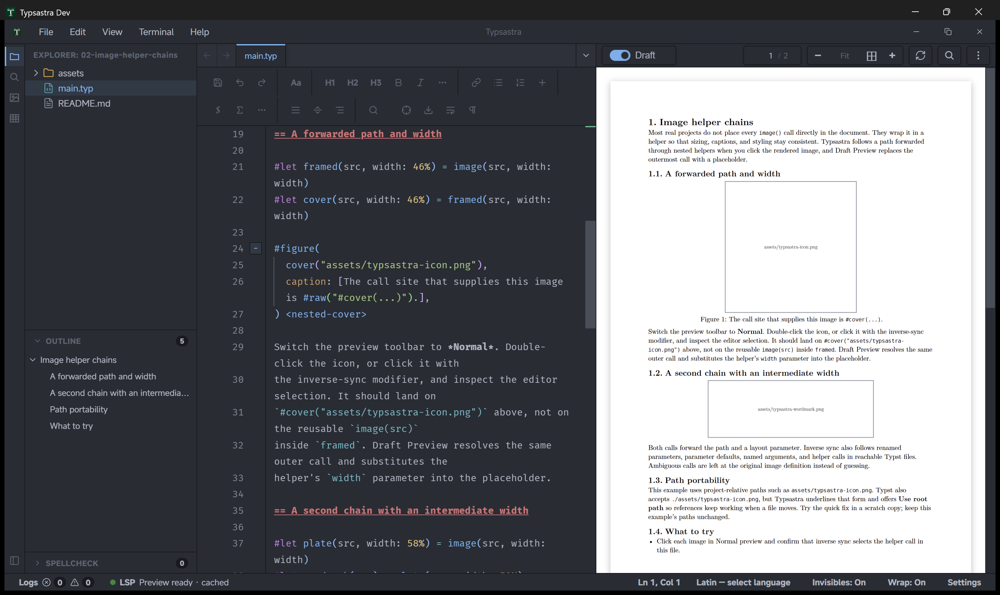
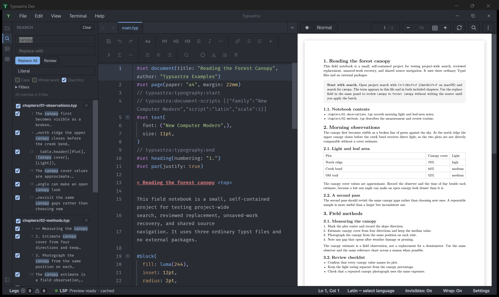
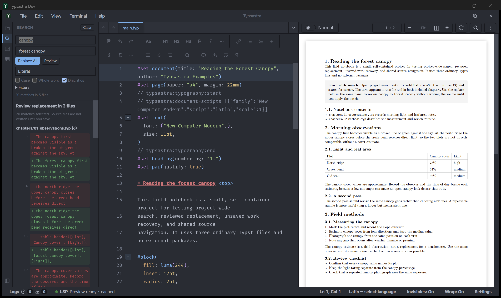
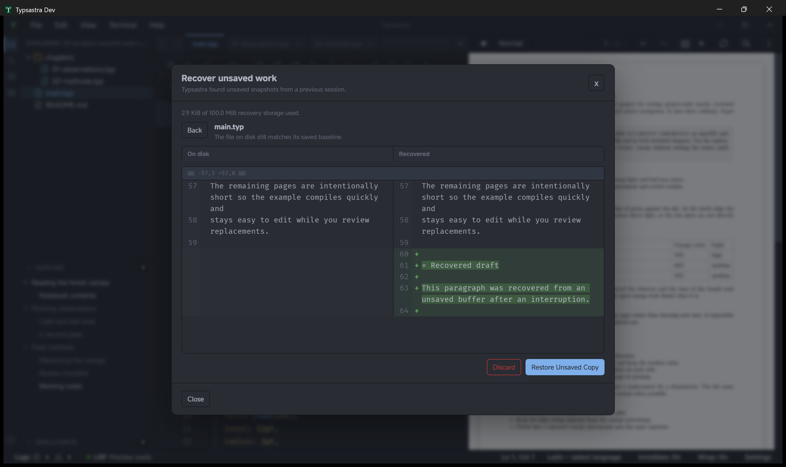
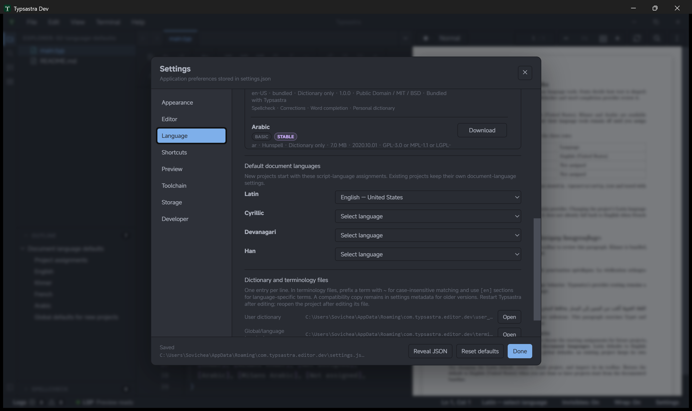
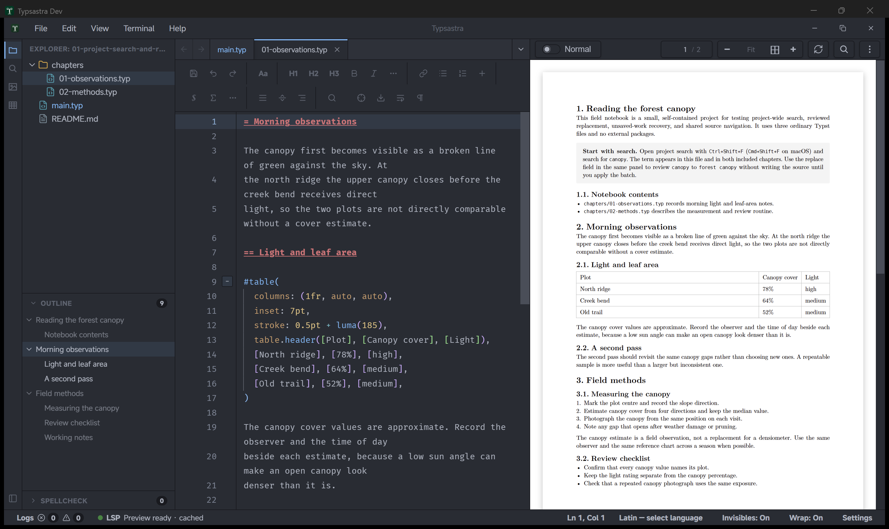
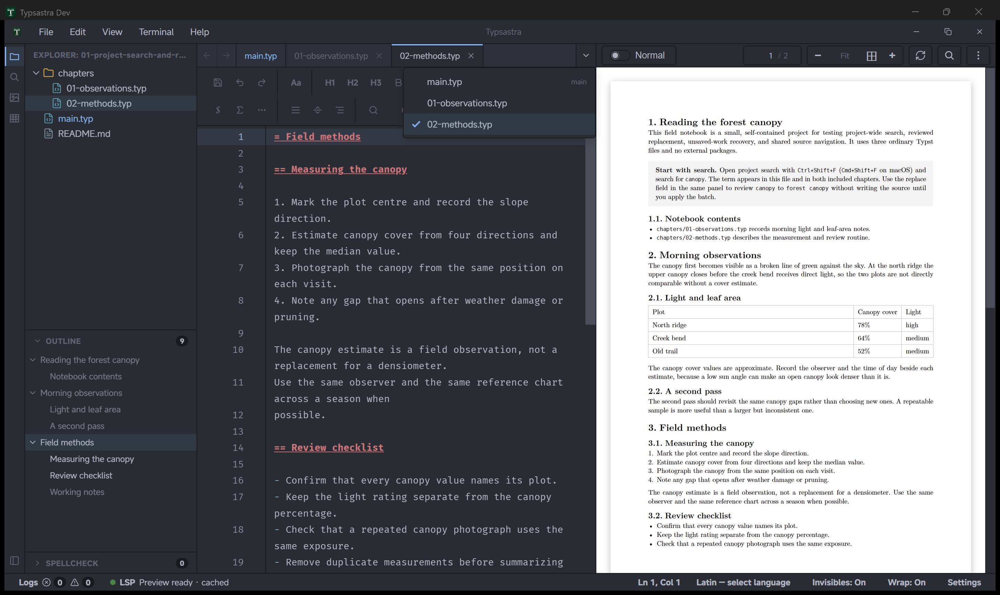
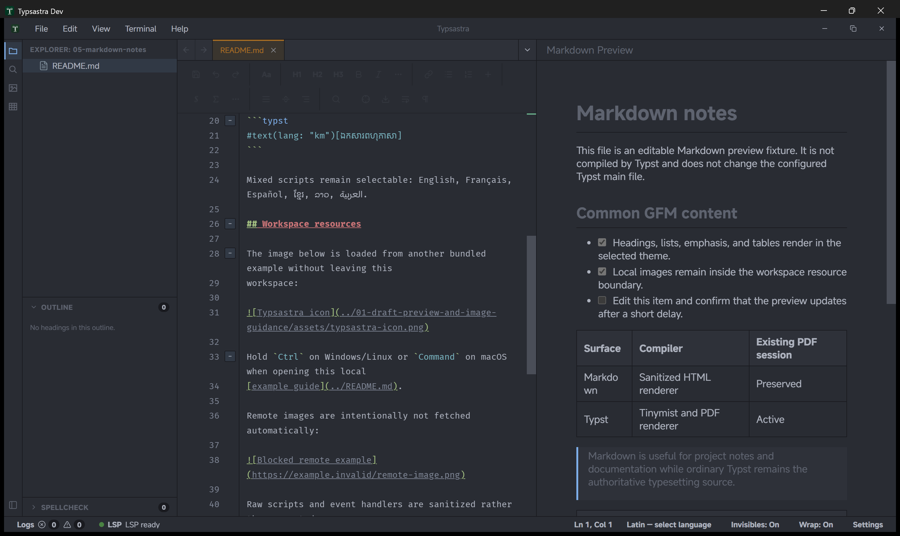
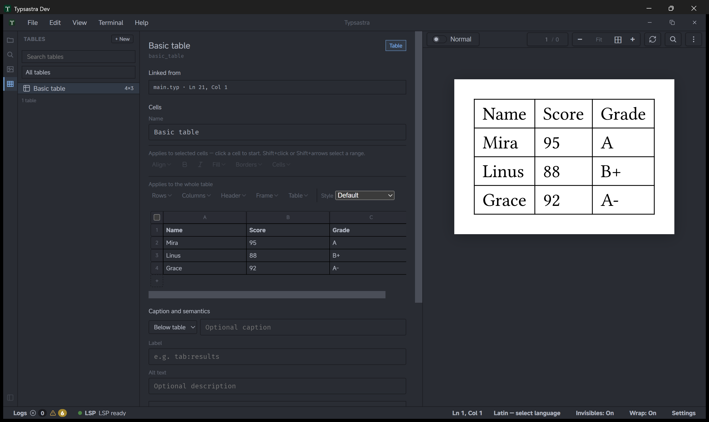
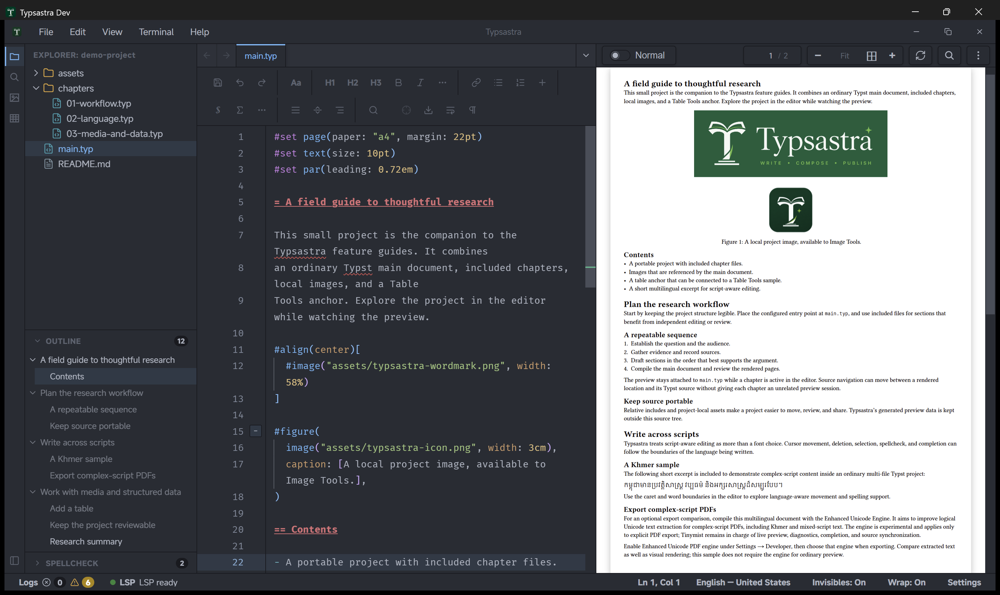

# Typsastra Documentation

Typsastra is a local-first writing environment for Typst, designed for research,
technical documentation, theses, books, and multilingual long-form writing.

This site brings together step-by-step workflows, tool references, language
guides, and contributor documentation.

## New in v0.10.1

Typsastra v0.10.1 extends image helper handling in both preview directions,
removes the first-click delay after a cached preview restore, and refreshes the
writable examples and documentation.

Read the [v0.10.1 release notes](RELEASE_NOTES_V0.10.1.md).

### Image helper chains

Inverse sync follows nested image helpers to the outermost call that supplied
the path, including forwarded parameters, defaults, and named arguments. Draft
Preview resolves same-file helper chains and preserves their width and height
values in the placeholder.

### Preview and editor reliability

Cached preview restores warm the source map before the first inverse-sync click,
and scrollbar and gutter markers identify their source after restores and tab
changes. Path-taking Typst functions warn about parent-relative paths and offer
a root-relative quick fix. Missing toolchains use a non-blocking title-bar badge.

## v0.10.0: Search, recovery, and navigation

Typsastra v0.10.0 adds project-wide search and reviewed replacement, a shared
main-document outline, Back/Forward source navigation, unsaved-work recovery,
and global default document languages.

Read the [v0.10.0 release notes](RELEASE_NOTES_V0.10.0.md).

The screenshots below use the writable
[`07-editor-workflows`](https://github.com/Sovichea/typsastra/tree/main/src-tauri/resources/examples/07-editor-workflows)
examples. Each exercise is a small, ordinary Typst project you can open from
**Open Examples** and edit safely.

### Search and replace across a project

### Recover unsaved work

### Set default document languages

### Main-document outline and tab navigation

The outline follows the configured main document while an included chapter is
active. The tab-list menu reaches every open source tab.

## Preview and media examples

The `06-preview-and-media` examples cover Draft Preview, nested image helper
chains, preview navigation, private fonts, and Markdown notes. The Markdown note
exercises sanitized GFM rendering, task lists, tables, workspace links and
images, mixed scripts, and blocked remote content.

See [Draft Preview](tutorials/DRAFT_PREVIEW.md), [PDF preview and
synchronization](tutorials/PDF_PREVIEW_AND_SYNC.md), [Image
Tools](tutorials/IMAGE_TOOLS.md), and [Markdown live
preview](tutorials/MARKDOWN_PREVIEW.md).

The previous v0.9.6 update improved Hunspell dictionary compatibility, added
LibreOffice spelling variants, streamlined language-provider management, and
fixed selection wrapping, paste, preview freshness, and stale diagnostic
behavior. See the [v0.9.6 release notes](RELEASE_NOTES_V0.9.6.md).

## Tools and templates examples

The `08-tools-and-templates` examples cover project-owned Table Tools blocks,
table export and import, and project creation from Universe, downloaded, and
user templates. The linked-table exercise can recover a table model from its
generated source when project metadata is missing.

See [Table Tools](tutorials/TABLE_TOOLS.md), [Create from
templates](tutorials/PROJECT_TEMPLATES.md), and [Project import and
export](tutorials/PROJECT_IMPORT_AND_EXPORT.md).

## Start here

- [Install Typsastra](INSTALL.md) — download a release or install from the project Scoop bucket.
- [Getting started](tutorials/GETTING_STARTED.md) — open or create your first project.
- [Projects and main files](tutorials/PROJECTS_AND_MAIN_FILES.md) — understand multi-file projects and main documents.
- [Create from templates](tutorials/PROJECT_TEMPLATES.md) — browse Universe, offline, and user templates.
- [PDF preview and synchronization](tutorials/PDF_PREVIEW_AND_SYNC.md) — work with live preview and source navigation.
- [Search a project](tutorials/PROJECT_SEARCH.md) — find and review replacements across project files.
- [Editor productivity](tutorials/EDITOR_PRODUCTIVITY.md) — navigation, recovery, shortcuts, and editing workflows.
- [Image Tools](tutorials/IMAGE_TOOLS.md) — inspect, crop, and optimize project images.
- [Table Tools](tutorials/TABLE_TOOLS.md) — create, link, and edit Typst tables.
- [Settings reference](SETTINGS.md) — configure editing, preview, language tools, and appearance.

## Watch feature demos

### Draft Preview

See image and diagram placeholders preserve document layout while you work:

<video controls preload="none" playsinline width="100%">
  <source src="https://github.com/user-attachments/assets/b1c45806-8747-4180-8e52-dbe8222f82db" type="video/mp4">
  Your browser cannot play the embedded video. <a href="https://github.com/user-attachments/assets/b1c45806-8747-4180-8e52-dbe8222f82db">Watch the Draft Preview demo.</a>
</video>

### Khmer and document typography

See script-aware font and language settings in a real workspace:

<video controls preload="none" playsinline width="100%">
  <source src="https://github.com/user-attachments/assets/f58e3133-e900-4a4b-9c63-7dee587b7e90" type="video/mp4">
  Your browser cannot play the embedded video. <a href="https://github.com/user-attachments/assets/f58e3133-e900-4a4b-9c63-7dee587b7e90">Watch the typography and language tools demo.</a>
</video>

## Explore the documentation

Use the navigation to browse tutorials and user references. The [feature
guide](FEATURES.md) groups the product documentation, while the [development
guide](DEVELOPMENT.md) covers building and validating Typsastra itself.
