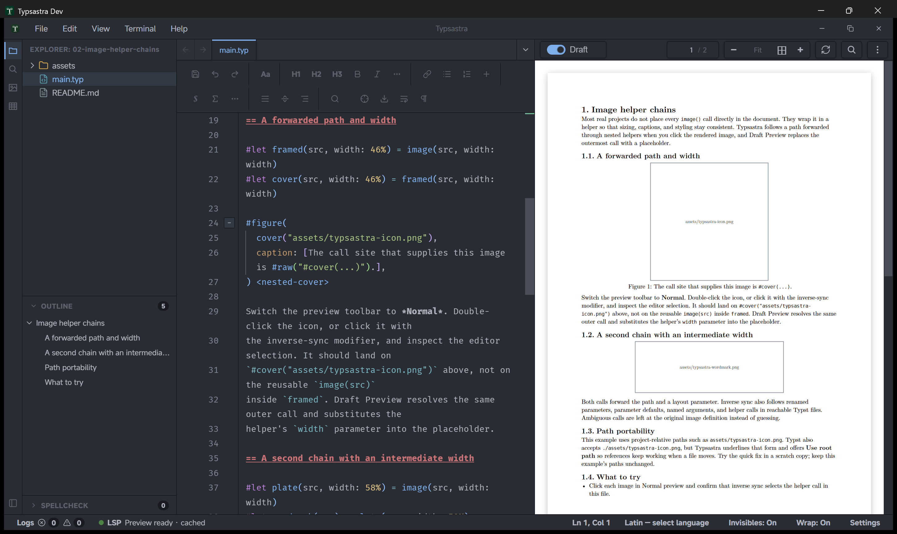
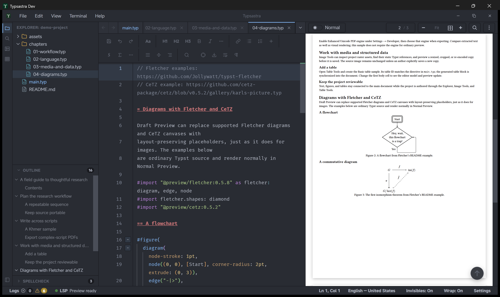
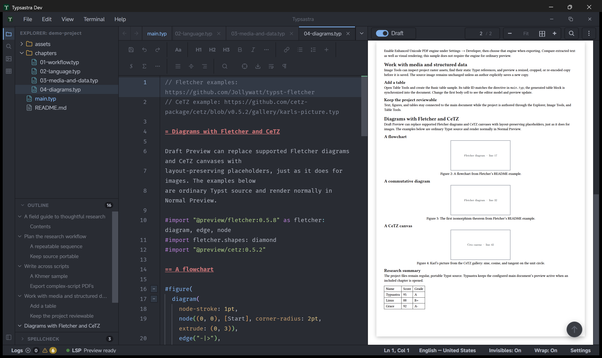
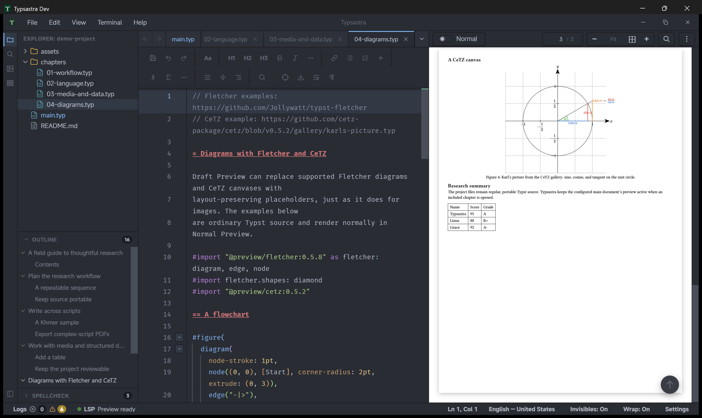

# Draft Preview

Draft Preview reduces the cost of iterating on image- and diagram-heavy Typst
documents. It replaces supported static raster `image()` calls, Fletcher
diagrams, and CeTZ canvases in Typsastra's private render mirror with
placeholders that preserve their measured layout. The project source, original
assets, and exported PDFs are not rewritten. Image helper functions that forward
a literal path through nested `#let` definitions are resolved as well, including
helper parameters for width and height, so the helper call site receives a
placeholder with the resolved layout.

## Switch preview modes

Use the **Normal / Draft** control in the live preview toolbar. Normal mode
renders the original images, diagrams, and canvases. Draft mode shows
lightweight placeholders while keeping their measured dimensions and positions
in the document. Switch back to Normal before export or final visual review; PDF
export uses original assets.

<video controls preload="none" playsinline width="100%">
  <source src="https://github.com/user-attachments/assets/b1c45806-8747-4180-8e52-dbe8222f82db" type="video/mp4">
  Your browser cannot play the embedded video. <a href="https://github.com/user-attachments/assets/b1c45806-8747-4180-8e52-dbe8222f82db">Open the Draft Preview demo.</a>
</video>

Hover over a draft image or diagram placeholder to inspect a bounded cached
thumbnail and its original dimensions and encoded size. Missing or unsupported
assets retain their layout space and report a diagnostic rather than silently
shifting the document.

Try the bundled
`06-preview-and-media/02-image-helper-chains` example to see a nested helper
call become the placeholder, including a helper-defined width. Clicking the
same image in Normal preview selects the outermost helper call that supplied
the path.

## Diagrams and canvases

Draft Preview also replaces statically resolvable Fletcher diagrams and CeTZ
canvases. The documentation demo project includes the flowchart and commutative
diagram from Fletcher's README, plus Karl's picture from the CeTZ gallery, in
[`04-diagrams.typ`](../demo-project/chapters/04-diagrams.typ).

Normal Preview renders the diagrams at their measured size:

Draft Preview keeps the same layout and labels each placeholder with its
diagram kind and source line:

The CeTZ canvas renders normally on the following page in Normal Preview:

## Image analysis and optimization

The preview toolbar and editor gutter can warn about raster assets whose
decoded pixel dimensions or encoded size are unusually large. These are
recommendations only: Typsastra does not silently resize or recompress source
assets. Use [Image Tools](IMAGE_TOOLS.md) to preview and save an optimized copy
explicitly.

## Cache and project behavior

Draft image and diagram work is stored in Typsastra's machine-local project
render cache, keyed to the configured main document and content mode. Source
files remain the authority. Generated thumbnails can be discarded and rebuilt
without changing the project.

The mode is shared across included files because they belong to the main
document's preview. Opening an included chapter does not create a separate
Draft Preview session or change the PDF page position.

## Limitations

Draft Preview only replaces supported static raster image references and
statically resolvable Fletcher/CeTZ calls that can be resolved inside the
project. Dynamic image paths, diagrams created through unsupported factories or
dynamic imports, plugin-generated content, remote resources, and unsupported
image formats may remain unchanged. A helper that wraps `image()` in a
`figure()` may also remain unchanged in Draft mode; place the `figure()` around
the helper call instead. Inspect the preview diagnostics when a specific image
or diagram was not replaced.
