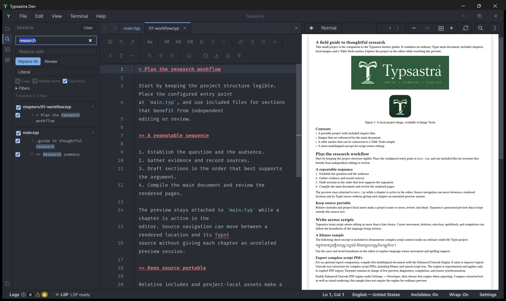
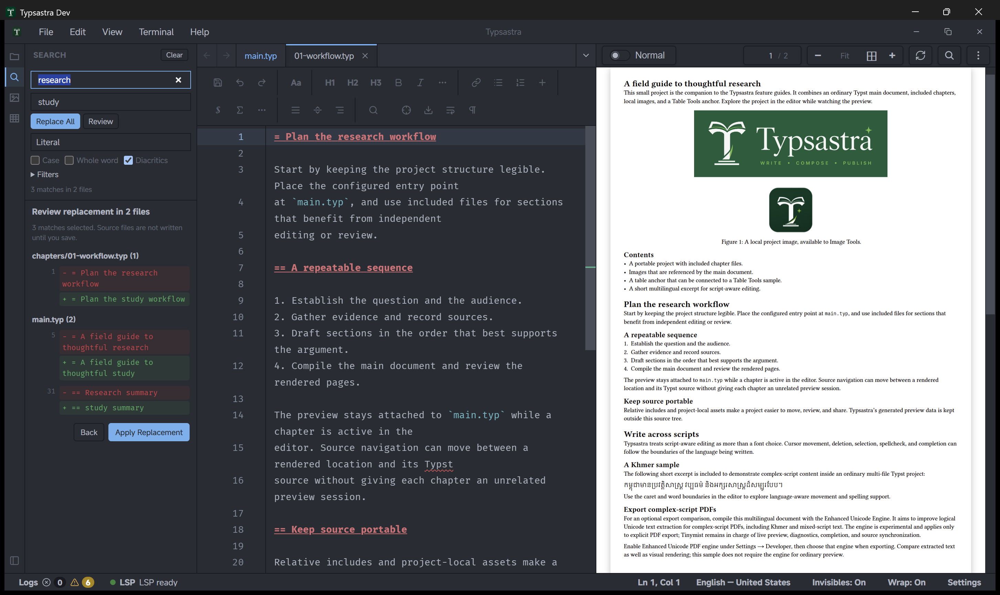

# Search a project

Project search finds text across the files in the current workspace without
opening each file first. It uses unsaved editor buffers when a file is open and
reads UTF-8 files from disk otherwise.

Open it from the magnifier in the activity bar, **Edit → Search Project**, or
`Ctrl+Shift+F` (`Cmd+Shift+F` on macOS). The Search panel replaces the sidebar
content; the editor and PDF preview stay visible.



## Search modes

- **Literal** searches for the text as entered. Match case, Whole word, and
  Diacritics use the same behavior as editor Find.
- **Regex** treats the query as a regular expression. Capture syntax and Unicode
  matching match editor Find. A single file whose expression takes longer than
  one second is stopped and the results are marked incomplete.
- **Fuzzy** ranks ordered subsequences in relative file paths and source lines.
  Path matches appear in their own section. Whole word, diacritics, and regex
  controls are disabled in this mode.

## Filters

**Main document only** is enabled by default. It limits results to the pinned
main document, the `.typ` files reachable through its `#include` and `#import`
graph, and local text files it references, such as bibliography files. Clear the
option to search every eligible file in the workspace. If no main document is
pinned, Typsastra searches the whole project and explains that fallback in the
result status.

Use **Filters** to add comma- or newline-separated include and exclude globs:

```text
chapters/**, *.typ
**/draft-*, *.bib
```

Patterns without a slash apply to the file name. `**` crosses directory
boundaries and `*` does not. Files ignored by `.gitignore`, binary files, files
larger than 10 MiB, and generated application data are skipped by default.
Enable **Include ignored files** to search ignored paths as well.

## Results

Results are grouped by relative file path and show line numbers and highlighted
excerpts. Select a content result to open its file and select the match without
moving the PDF. Selecting a fuzzy path match opens the file without selecting a
source range.

Queries run in a background worker after a short typing pause. Typsastra cancels
work for an older query and shows at most 20,000 matches; the status line reports
truncated or incomplete results. Changed files are checked before navigation. If
a file changed since the result was produced, the search refreshes instead of
applying stale offsets.

## Replace across files

Literal and Regex searches can replace selected matches across the project. Open
the replace field with **Edit → Replace in Project** or `Ctrl+Shift+H`
(`Cmd+Shift+H` on macOS), or type a replacement directly in the Search sidebar.



1. Run a search and wait for it to finish. Replacement is unavailable while a
   search is still running, incomplete, truncated, or errored.
2. Type the replacement text.
3. Select **Replace All** to replace every safe match immediately and skip the
   review step.
4. To replace only some matches, clear the checkbox beside any match you want to
   keep, use a file checkbox to include or exclude all safe matches in that file,
   then select **Review**. Inspect each changed line as a before/after pair and
   select **Apply Replacement**.

Typsastra applies one undoable edit per file and opens previously closed files
as unsaved tabs. The source files are not written during replacement. Review the
unsaved tabs and use normal **Save** or Auto-save when the changes are ready.

Matches that would split a grapheme cluster are marked non-replaceable and are
skipped. If any selected file changed after the search, nothing is applied and
the results refresh.

Use **Undo Replace** in the Search sidebar to restore every file from the latest
replacement. The button appears after a replacement and is only offered while
all affected buffers still match the batch output. Normal per-file **Undo** is
always available; editing any affected buffer also disables the batch undo so it
cannot overwrite newer work. With On-type preview, the batch produces one preview
update after it completes rather than one update per file.

## Limits and privacy

Project search stays inside the workspace. It does not search generated app
caches, project archives, binary files, or paths outside the workspace. Query
and replacement text, results, and the latest undo batch are session-only; they
are not written to project settings.
